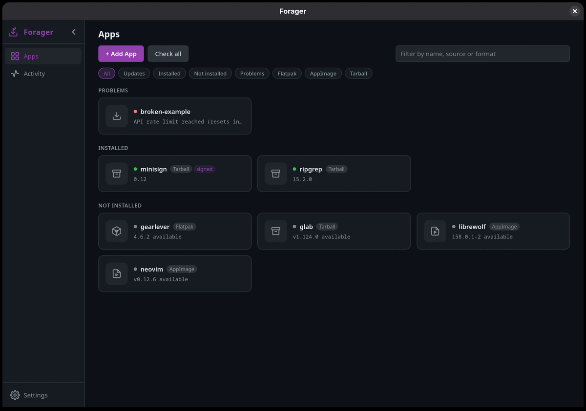
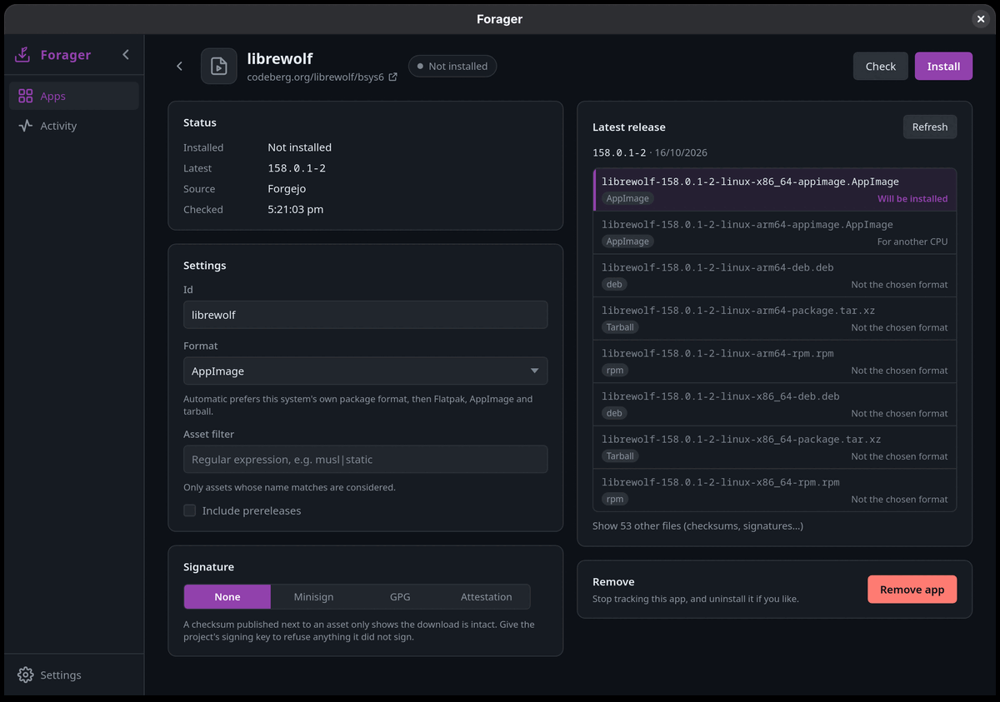
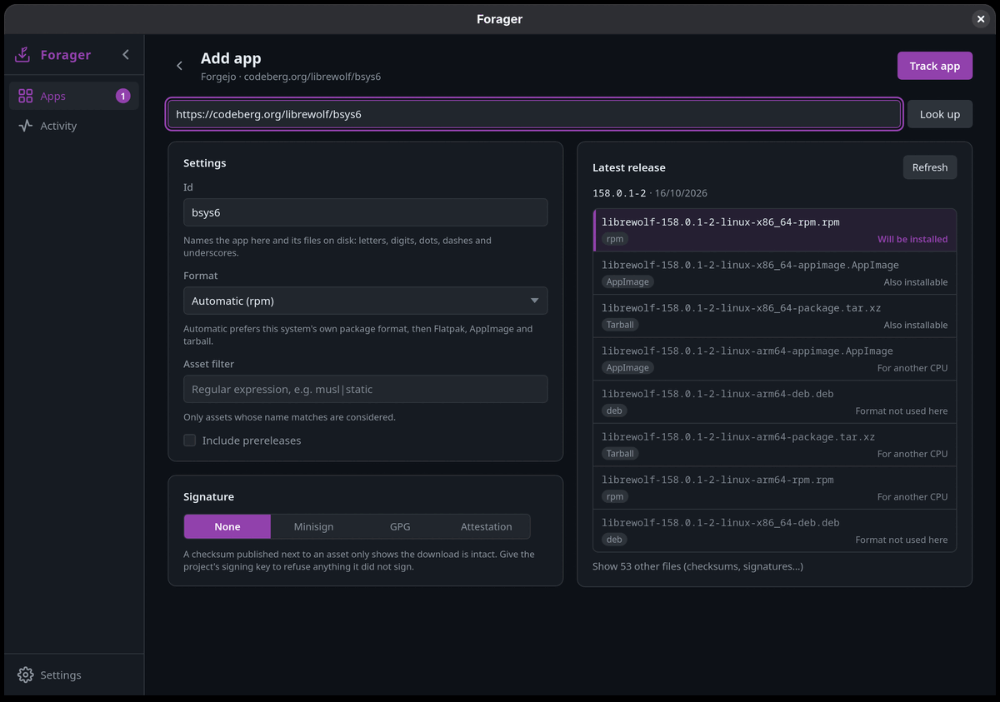
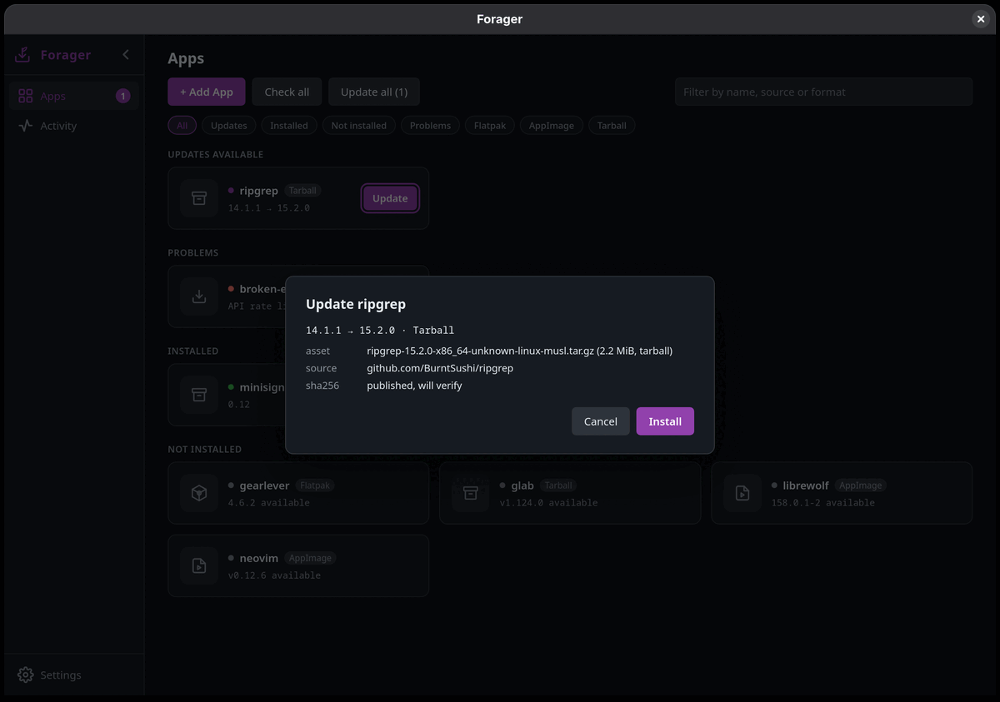
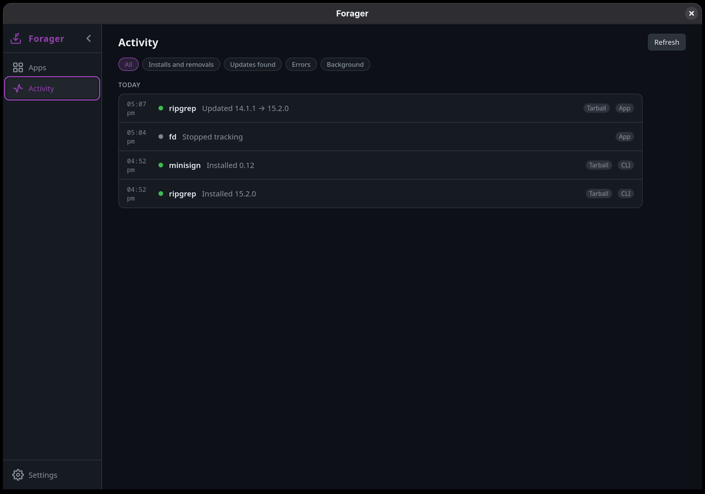
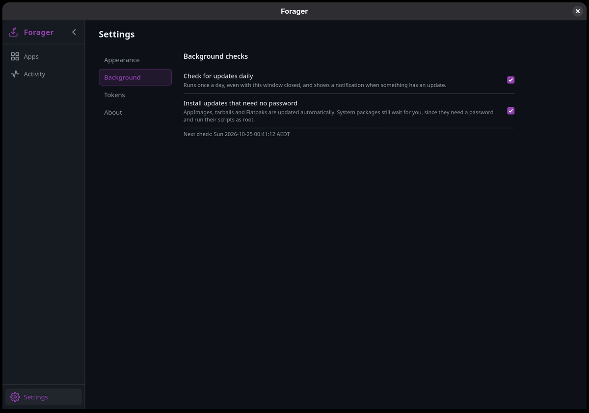

# Forager

Install and update desktop Linux apps straight from their GitHub, GitLab,
Codeberg, SourceForge and SourceHut releases, using the system package
manager. Think
[Obtainium](https://github.com/ImranR98/Obtainium), but for the desktop.



## Status

Early, but usable: a desktop app and a CLI over the same core.

- Sources: GitHub, GitLab (gitlab.com, GNOME, freedesktop, KDE, Debian Salsa,
  Framagit, or self-hosted) and Forgejo/Gitea (Codeberg or self-hosted)
  releases, or any web page that links to the downloads
- Formats: `.rpm` (dnf, zypper), `.deb` (apt), Arch packages
  (`.pkg.tar.*`, `.pacman`; pacman), AppImage (`~/Applications`),
  tarballs (`~/.local/opt/<id>`, executables linked into `~/.local/bin`),
  Flatpak bundles (`flatpak install --user`)
- Verification: SHA-256 from GitHub's asset digest or a published
  `SHA256SUMS` / `checksums.txt` / `<asset>.sha256` file

## Install

Each [release](https://github.com/AalmanSadath/forager/releases) has:

| File | For | Install |
| --- | --- | --- |
| `forager_<v>_amd64.deb` | Debian 13, Ubuntu 24.04 and newer | `sudo apt install ./forager_<v>_amd64.deb` |
| `forager-<v>-1.x86_64.rpm` | Fedora, openSUSE | `sudo dnf install ./forager-<v>-1.x86_64.rpm` |
| `forager-<v>-1-x86_64.pkg.tar.zst` | Arch | `sudo pacman -U forager-<v>-1-x86_64.pkg.tar.zst` |
| `forager-<v>-x86_64.flatpak` | any distribution with Flatpak | `flatpak install --user forager-<v>-x86_64.flatpak` |
| `Forager-<v>-x86_64.AppImage` | any distribution | `chmod +x` it and run it |
| `forager-<v>-x86_64-linux.tar.gz` | any distribution | unpack, then `./install.sh` (into `~/.local`) |

`SHA256SUMS` lists every file's checksum. All of them except the AppImage
contain both the app (`forager-gui`) and the CLI (`forager`).

Every file also has a GitHub build attestation: a Sigstore-signed record
that this repository's release workflow built it from the tagged commit.
Check one with the GitHub CLI:

```sh
gh attestation verify forager-<v>-1.x86_64.rpm -R AalmanSadath/forager
```

The Flatpak is a convenience, not a sandbox: Forager installs software for
the host, so it runs the host's package tools through `flatpak-spawn
--host`, reads and writes your home directory, and talks to PackageKit.
Its permissions are listed, with reasons, in
`packaging/flatpak/io.github.aalmansadath.Forager.yml`.

Forager can keep itself up to date like any other app:

```sh
forager add https://github.com/AalmanSadath/forager --attestation   # verify each update (needs `gh auth login`)
forager edit forager --format flatpak   # only if you installed the Flatpak
```

## The app

Forager's window lists every tracked app with what is installed and
what is new, grouped into updates, problems, installed and not installed.

An app's page shows its install, its settings, and every asset of the
latest release with the reason each one was or was not chosen. Changing
the format, the asset filter or the executables re-runs that choice as
you type. Adding an app works the same way: paste the address, look it
up, adjust, track.

| App page | Adding an app |
| --- | --- |
|  |  |

Updating shows what will be installed and how it is verified before
anything is downloaded, then downloads with progress (cancellable),
verifies and installs. System packages ask for a password through
PackageKit. The Activity page lists what the app, the CLI and the
background check did, and Settings covers the theme (System, Dark,
Light, AMOLED, with the desktop's accent colour), the daily background
check, API tokens and where files live.

| Updating | Activity | Settings |
| --- | --- | --- |
|  |  |  |

`forager-gui add <url>` opens the add page for an address, and
`forager-gui open <id>` an app's page.

### Building the app

The app is a [Tauri 2](https://tauri.app) shell around the same core,
with a React frontend in `gui/`. It needs Node 20 or newer and the
WebKitGTK 4.1 development files (`webkit2gtk4.1-devel` on Fedora,
`libwebkit2gtk-4.1-dev` on Debian and Ubuntu).

```sh
cd gui
npm ci
npx tauri dev        # run from source
npx tauri build      # deb, rpm and AppImage under target/release/bundle
```

The packages install both `forager-gui` and the `forager` CLI, which the
background check runs. `packaging/build-all.sh` builds every release file
into `target/dist`; see the comments in `packaging/` for each format. The
release workflow builds them on Ubuntu 24.04, so the binaries also run on
older systems than the one building them.

## Usage

```sh
cargo build --release
forager add https://github.com/jgraph/drawio-desktop
forager add https://gitlab.com/gitlab-org/cli --id glab
forager add https://git.example.org/team/tool --forge forgejo   # self-hosted
forager add https://nodejs.org/dist/latest/ --forge html \
    --pattern 'node-v[0-9.]+-linux-x64\.tar\.xz$' --bin bin/node     # a download page
forager add https://sourceforge.net/projects/smplayer --format appimage
forager add https://git.sr.ht/~emersion/kanshi --track-only
forager add https://ci.example.org/job/tool/                    # a Jenkins job's archived files
forager add https://zoom.us/client/latest/zoom_x86_64.rpm       # a link straight to the file
forager check            # show installed vs latest and the asset that would be used
forager check --json     # the same as JSON, for scripts and status bars (also list, history)
forager update           # install or upgrade every tracked app (asks first)
forager update drawio-desktop --yes
forager edit drawio-desktop --format appimage   # or --format auto, --filter, --bin, --prerelease
forager edit bifrossh --tag-filter '^v'         # follow only v… releases, not android-v…
forager remove drawio-desktop
forager notes drawio-desktop             # release notes of the latest release (or --tag)
forager skip drawio-desktop              # do not offer the latest release; newer ones are
forager unskip drawio-desktop
forager install drawio-desktop --tag v24.0.0   # roll back; skips the release rolled back from
forager add https://github.com/ImranR98/Obtainium --track-only   # report new releases, never install
forager seen obtainium                   # stop reporting the latest release as new
```

Forager looks for an app on every check, in every format its release
offers that suits the system: deb (dpkg), rpm (dnf or zypper), Arch package
(pacman) and Flatpak (user or system-wide). An install made by hand, from
the distribution or before the app was added is recognised by the name in
its release files and is not installed again, and its version is read from
the package manager, so upgrades and downgrades made outside Forager are
seen. An app installed in several formats at once, say an rpm and a
Flatpak, is tracked in each, and each is updated in its own format;
removing the app asks which to uninstall. If one is removed outside
Forager while another remains, Forager follows the one that remains.

A tracked-only app (`--track-only`, or "Track only" in the app's settings)
is never installed: `check`, the timer's notification and the Apps page
report its releases newer than the one last marked as seen, with a link to
the release page. Use it for apps with no Linux build, or ones installed
some other way.

The latest release is the newest one with a file for this system, so a
project that also tags, say, Android builds in the same repository still
finds its Linux release.

AppImages and tarballs get a menu entry: an AppImage's own `.desktop` file
and icon, read from the image without running it, or the entry a tarball
ships in `share/applications` (command-line tools without one get none).
They are written as `forager-<id>` in `~/.local/share/applications` and
`~/.local/share/icons`, and removed with the app. For ones installed before
Forager made entries, run `forager menu-entries`, or use "Add menu entries"
on the Apps page.

Shell completions and man pages come with the deb, rpm, Arch package and
tarball. For other installs, `forager completions bash|zsh|fish` prints the
script.

Background checks run from a systemd user timer:

```sh
forager timer enable                 # daily `check --notify`: a desktop notification lists updates
forager timer enable --auto-update   # also installs updates that need no root (AppImage, tarball, Flatpak)
forager timer status
forager timer disable
```

`forager history` lists what was installed, updated, removed or failed, and
updates the timer found, from the CLI, the timer and the GUI alike
(`~/.local/state/forager/history.jsonl`).

The timer reads `GITHUB_TOKEN` and other variables from `~/.config/forager/env`.
`update --unprivileged-only` skips anything that needs root, so the timer
never asks for a password.

`edit` changes an app's settings; a new format is installed (and the old
install removed) on the next `update`.

`add` options: `--id`, `--forge gitlab|forgejo|jenkins|direct` for
addresses Forager does not recognise, `--forge html --pattern <regex>` for a web page of download links
(links whose full address matches are the downloads; the version is a
`(?P<version>...)` group, or else the first dotted number in the file name),
`--filter <regex>` to restrict asset names,
`--format deb|rpm|pacman|appimage|tarball|flatpak` to override format selection,
`--prerelease`, `--bin <path>` (repeatable) to name the executables to link
from a tarball, relative to its top directory.

Besides the forges, Forager reads SourceForge projects (their file feed,
one release per folder), SourceHut repositories (tags and the files
attached to them), Jenkins jobs (each successful build with archived files,
tagged `build-<number>`; public jobs only) and direct links to a file. A
direct link's version is the one in the name or folder of the file it
leads to, else the file's date, so a link that always serves the latest
build still shows its updates; one with no file name in the address needs
`--forge direct`. SourceForge publishes only MD5 sums, so its downloads
count as unverified unless the project signs them.

Tracked apps live in `~/.config/forager/apps.toml` (override with `--config`
or `FORAGER_CONFIG`). Set `GITHUB_TOKEN` to raise the GitHub API limit from
60 to 5000 requests per hour. Release lists are cached in `~/.cache/forager`
and fetched conditionally; with a GitHub token, checking an app whose
releases have not changed does not use up the limit. `GITLAB_TOKEN` is used
for gitlab.com and `CODEBERG_TOKEN` for codeberg.org. For any host,
`FORAGER_TOKEN_<HOST>` (e.g. `FORAGER_TOKEN_GIT_EXAMPLE_ORG`) takes
precedence; a token is only ever sent to its own host.

Only one Forager process works on a config at a time; a second one waits.
Installs removed outside Forager (`dnf remove`, a deleted AppImage) show as
`missing` in `check` and are reinstalled by `update`. Switching an app to
another format removes the old install once the new one is in place.

When a deb, rpm or Arch package is also in the distribution's repositories,
`update` says so and asks again before the first install, since system
updates and the forge's build can replace each other. `check` marks such
installs with the distro's version.

## How an asset is chosen

1. Formats the system can install, in order: native package format first
   (rpm on dnf/zypper systems, Arch packages on pacman systems, deb on apt
   systems), then Flatpak if
   `flatpak` is installed, then AppImage, then tarball.
2. Assets naming this CPU architecture beat assets naming none; assets
   naming another architecture or operating system are skipped.
3. Debug and source packages are skipped, as are tarballs naming neither
   Linux nor this architecture (usually source archives).

A tarball's single top-level directory is unwrapped. Without `--bin`,
Forager links the one executable in that directory or its `bin/`; if there
are several, the one named after the app id. Files in `~/.local/bin` that
Forager did not create are never replaced.

Man pages and shell completions a tarball ships for its executables (a
`share/` tree, or files such as `doc/rg.1` and `complete/_rg`) are linked
into `~/.local/share/man` and the bash, zsh and fish completion directories
under `~/.local/share`; zsh needs `fpath+=~/.local/share/zsh/site-functions`
in `~/.zshrc`. Files there that Forager did not create are left alone.

## System packages

deb, rpm and Arch packages are installed and removed through PackageKit
over D-Bus, which asks polkit for permission and reports progress. Where
PackageKit is missing, or polkit refuses it because there is no graphical
authentication agent (e.g. over SSH), Forager runs the native tool (dnf,
zypper, apt-get, pacman) under `pkexec` instead, which can ask on the
terminal.

## Security

Installing a `.deb`, `.rpm` or Arch package runs the package's scripts as
root, so it means trusting the upstream project and its forge account
completely.
Forager shows the asset and whether it can be verified before installing,
and with `--yes` it refuses unverified assets unless `--allow-unverified`
is given. A checksum published next to the asset only guards against
corrupted downloads, not a compromised release.

To guard against that, give Forager the project's signing key; assets
without a valid signature are then refused, with no override:

```sh
forager add https://github.com/jedisct1/minisign --bin x86_64/minisign \
    --minisign-key RWQf6LRCGA9i53mlYecO4IzT51TGPpvWucNSCh1CBM0QTaLn73Y7GFO3
forager add https://github.com/keepassxreboot/keepassxc --gpg-key keepassxc.asc
forager add https://github.com/owner/repo --attestation   # GitHub attestations, needs `gh auth login`
forager edit keepassxc --no-signature
```

Forager looks for `<asset>.minisig`, or `<asset>.asc` / `.sig` / `.gpg`,
and falls back to a signed checksum list such as `SHA256SUMS.asc`. GPG keys
are kept in `~/.local/share/forager/keys` and checked with `gpgv`; nothing
is added to your own keyring. Get the key from the project's website or
check its fingerprint there, not from the release being verified.

## Layout

- `crates/forager-core`: sources, asset matching, version comparison,
  verification, installation, config store, history
- `crates/forager-cli`: the `forager` command
- `gui/`: the desktop app; `gui/src-tauri` is its Rust side (crate
  `forager-gui`), `gui/src` the React frontend. Its look follows
  [BifroSSH](https://github.com/AalmanSadath/BifroSSH), whose colour
  tokens it shares.

## Licence

GPL-3.0-or-later; see `LICENSE`.
